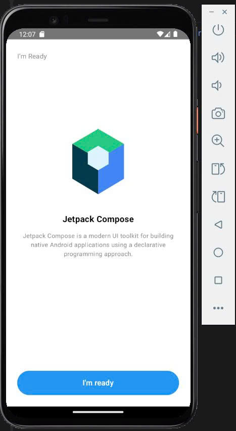
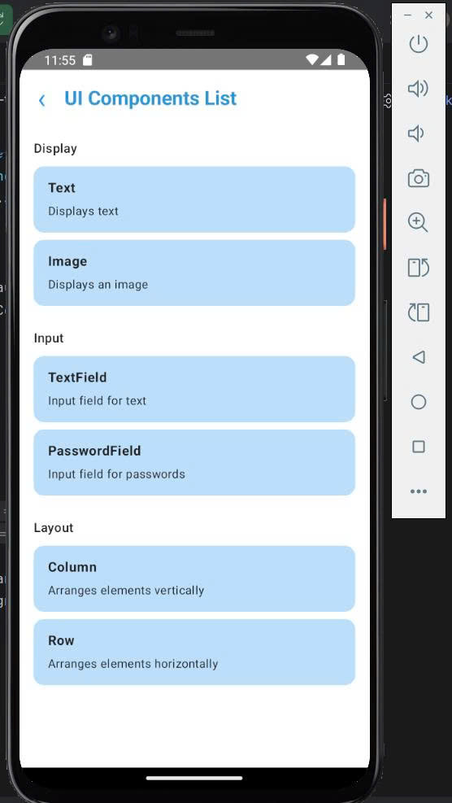
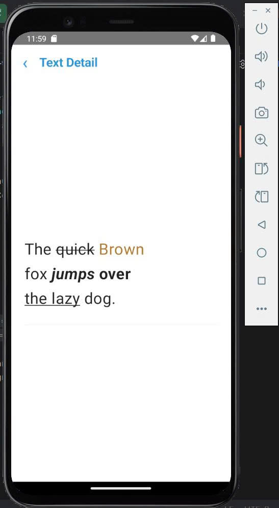

# Source Code – Bài tập 1: Các thành phần UI cơ bản - Tuần 4
## 1. Tổng quan chương trình
Chương trình xây dựng ứng dụng Android minh họa các thành phần giao diện người dùng cơ bản bằng Kotlin và Jetpack Compose.
Ứng dụng gồm các màn hình:
- Màn hình giới thiệu Jetpack Compose.
- Màn hình danh sách các thành phần UI.
- Màn hình chi tiết Text.
- Màn hình minh họa Image, TextField và PasswordField.
- Màn hình giới thiệu cách bố trí giao diện bằng Column và Row.

Người dùng có thể nhấn nút để chuyển từ màn hình giới thiệu đến danh sách thành phần, chọn từng thành phần để xem nội dung minh họa và quay lại danh sách.
File mã nguồn chính là `MainActivity.kt`.
## 2. Khai báo màu sắc và màn hình
Chương trình khai báo các màu dùng chung:
```kotlin
private val Blue = Color(0xFF2196F3)
private val LightBlue = Color(0xFFBBDEFB)
private val BackgroundColor = Color(0xFFF7F9FC)
private val TextColor = Color(0xFF222222)
```
Chương trình sử dụng `enum class Screen` để xác định màn hình hiện tại, bao gồm màn hình giới thiệu, danh sách thành phần và các màn hình chi tiết.
## 3. Xây dựng màn hình giới thiệu
Hàm `WelcomeScreen()` hiển thị màn hình giới thiệu Jetpack Compose.
Các thành phần chính:
- Dòng chữ `I'm Ready`.
- Hình minh họa logo Jetpack Compose.
- Tiêu đề `Jetpack Compose`.
- Đoạn văn giới thiệu công nghệ.
- Nút `I'm ready`.

Nút `I'm ready` nhận sự kiện thông qua tham số `onReady`. Khi người dùng nhấn nút, ứng dụng chuyển sang màn hình danh sách UI Components.
Hàm `ComposeLogo()` sử dụng `Canvas` và `Path` để vẽ hình minh họa bằng các đa giác màu xanh lá, xanh dương và xanh đen.
## 4. Xây dựng danh sách UI Components
Hàm `ComponentsScreen()` hiển thị danh sách các thành phần được chia thành ba nhóm:

| Nhóm        | Thành phần | Chức năng |
|-------------|---|---|
| Display     | Text | Hiển thị văn bản |
| Display     | Image | Hiển thị hình ảnh |
| Input       | TextField | Nhập văn bản |
| Input       | PasswordField | Minh họa trường nhập mật khẩu |
| Layout      | Column | Sắp xếp thành phần theo chiều dọc |
| Layout      | Row | Sắp xếp thành phần theo chiều ngang |

Mỗi thành phần được hiển thị bằng hàm `ComponentCard()`.
Hàm này nhận ba tham số:
- `title`: tên thành phần.
- `description`: mô tả chức năng.
- `onClick`: hành động khi người dùng nhấn vào thẻ.

Cách tổ chức này giúp tái sử dụng giao diện và hạn chế việc viết lặp lại nhiều đoạn code.
## 5. Xây dựng hàm ComponentCard
```kotlin
@Composable
private fun ComponentCard(
    title: String,
    description: String,
    onClick: () -> Unit
)
```
### Ý nghĩa các tham số

| Tham số | Chức năng |
|---|---|
| `title: String` | Lưu tên thành phần UI |
| `description: String` | Lưu nội dung mô tả |
| `onClick: () -> Unit` | Hàm xử lý khi người dùng nhấn vào thẻ |

Bên trong hàm, `Column` sắp xếp tên và mô tả theo chiều dọc. `Modifier.clickable` giúp người dùng nhấn vào thẻ để mở màn hình chi tiết.
Màu nền, khoảng cách và hình dạng bo góc được thiết lập bằng `background()`, `padding()` và `RoundedCornerShape`.
## 6. Xây dựng màn hình chi tiết Text
Hàm `TextDetailScreen()` minh họa cách định dạng văn bản bằng Jetpack Compose.
Nội dung hiển thị là câu:
`The quick Brown fox jumps over the lazy dog.`

Chương trình sử dụng `buildAnnotatedString` và `SpanStyle` để áp dụng nhiều kiểu định dạng trong cùng một đoạn văn bản.
Các định dạng được minh họa:
- Gạch ngang bằng `TextDecoration.LineThrough`.
- Thay đổi màu chữ bằng `SpanStyle(color = ...)`.
- Chữ đậm bằng `FontWeight.Bold`.
- Chữ nghiêng bằng `FontStyle.Italic`.
- Gạch chân bằng `TextDecoration.Underline`.

Cách làm này cho phép định dạng riêng từng phần văn bản thay vì áp dụng một kiểu duy nhất cho toàn bộ nội dung.
## 7. Minh họa các thành phần Input

### TextField

Hàm `TextFieldDetailScreen()` sử dụng `OutlinedTextField` để cho phép người dùng nhập văn bản.

```kotlin
var text by remember { mutableStateOf("") }

OutlinedTextField(
    value = text,
    onValueChange = { text = it },
    label = { Text("Enter your text") }
)
```
- `mutableStateOf("")`: khởi tạo trạng thái văn bản rỗng.
- `remember`: giữ trạng thái qua các lần Compose dựng lại giao diện thông thường.
- `value`: nội dung hiện tại của ô nhập.
- `onValueChange`: cập nhật trạng thái khi người dùng nhập hoặc xóa văn bản.

Nội dung đã nhập được hiển thị bên dưới ô nhập.

### PasswordField

Hàm `PasswordDetailScreen()` minh họa trường nhập mật khẩu bằng `OutlinedTextField`.

Trong phiên bản hiện tại, trường nhập chưa che các ký tự mật khẩu. Chức năng chính là nhận dữ liệu và hiển thị số lượng ký tự đã nhập.

## 8. Minh họa các thành phần Layout và điều hướng

### Column và Row

Hai màn hình chi tiết minh họa chức năng bố trí giao diện:

- `Column`: sắp xếp các thành phần theo chiều dọc.
- `Row`: sắp xếp các thành phần theo chiều ngang.

Trong phiên bản hiện tại, hai thành phần này được giới thiệu bằng tiêu đề và mô tả chức năng.

### Điều hướng màn hình

Hàm `BaiTap1Buoi3App()` quản lý màn hình đang hiển thị bằng biến trạng thái:

```kotlin
var currentScreen by remember {
    mutableStateOf(Screen.Welcome)
}
```

Cấu trúc `when` lựa chọn màn hình dựa trên giá trị `currentScreen`.

Khi người dùng nhấn nút `I'm ready`, trạng thái chuyển sang `Screen.Components`. Khi nhấn vào một thành phần, trạng thái chuyển sang màn hình chi tiết tương ứng. Nút quay lại đưa người dùng về danh sách UI Components.

## 9. Các thành phần Jetpack Compose sử dụng

| Thành phần | Chức năng |
|---|---|
| `Scaffold` | Tạo bố cục chính cho màn hình có thanh tiêu đề |
| `TopAppBar` | Hiển thị tiêu đề và nút quay lại |
| `Column` | Sắp xếp các thành phần theo chiều dọc |
| `Row` | Sắp xếp các thành phần theo chiều ngang |
| `Box` | Chồng hoặc căn chỉnh các thành phần |
| `Text` | Hiển thị văn bản |
| `Button` | Tạo nút tương tác |
| `OutlinedTextField` | Tạo ô nhập văn bản |
| `Canvas` | Vẽ hình minh họa |
| `Path` | Xác định các đường và đa giác dùng để vẽ |
| `Spacer` | Tạo khoảng cách |
| `Modifier.clickable` | Xử lý thao tác nhấn |
| `remember` | Giữ trạng thái trong các lần dựng lại giao diện thông thường |

## 10. Kết quả kiểm thử

Các trường hợp kiểm thử chính:

| Trường hợp | Kết quả mong đợi |
|---|---|
| Mở ứng dụng | Hiển thị màn hình giới thiệu |
| Nhấn `I'm ready` | Mở danh sách UI Components |
| Chọn Text | Mở màn hình Text Detail |
| Chọn Image | Mở màn hình minh họa Image |
| Chọn TextField | Hiển thị ô nhập văn bản |
| Chọn PasswordField | Hiển thị trường nhập mật khẩu |
| Chọn Column hoặc Row | Hiển thị mô tả chức năng bố trí |
| Nhấn quay lại | Trở về danh sách UI Components |

Các trường hợp trên cần được chạy thử trên emulator hoặc thiết bị Android để xác nhận kết quả thực tế.

## 11. Ảnh chụp kết quả và bài học

### Ảnh chụp kết quả
```markdown

```
```markdown

```
```markdown

```
Tên file trong README cần trùng với tên ảnh thực tế.

### Bài học

Bài tập giúp em làm quen với Jetpack Compose, cách xây dựng các thành phần UI cơ bản, quản lý trạng thái bằng `remember` và `mutableStateOf`, xử lý sự kiện nhấn, định dạng văn bản và tổ chức luồng điều hướng giữa các màn hình.

Thông qua bài tập, em hiểu hơn cách chia giao diện thành các hàm `@Composable` để mã nguồn rõ ràng, dễ bảo trì và tái sử dụng.
