# Source Code – Bài tập 2: Hệ thống Quản lý Thư viện – Tuần 4

## 1. Tổng quan chương trình

Chương trình xây dựng ứng dụng Android quản lý sách và phiếu mượn bằng **Kotlin** và **Jetpack Compose**, áp dụng lập trình hướng đối tượng (OOP).

Các chức năng chính:

- Hiển thị danh sách sách và trạng thái có sẵn/đang được mượn.
- Thêm sách với mã sách, tên sách, tác giả và ngày nhập kho.
- Tạo phiếu mượn bằng cách chọn người mượn, sách, ngày mượn và ngày trả dự kiến.
- Theo dõi sách sinh viên đang mượn.
- Xác nhận trả sách, tự nhận diện quá hạn và tính số ngày trả muộn.

## 2. Khai báo lớp Book

Lớp `Book` lưu thông tin và trạng thái của một cuốn sách.

Các thuộc tính chính:

- `id`: mã sách.
- `title`: tên sách.
- `author`: tên tác giả.
- `entryDate`: ngày nhập kho.
- `borrowed`: trạng thái sách đang được mượn hay không.

Các hàm như `getId()`, `getTitle()`, `getAuthor()`, `getEntryDate()`, `borrow()` và `returnBook()` hỗ trợ lấy thông tin và cập nhật trạng thái sách.

## 3. Khai báo lớp Loan

Lớp `Loan` đại diện cho một phiếu mượn, liên kết một sinh viên với một cuốn sách.

Thông tin được quản lý:

- Người mượn và sách được mượn.
- Ngày mượn và ngày trả dự kiến.
- Ngày trả thực tế.
- Trạng thái phiếu mượn và số ngày trả muộn.

Hàm `getStatus()` xác định sách đang mượn, quá hạn hoặc đã trả. Hàm `getLateDays()` tính số ngày trễ dựa trên ngày trả dự kiến và ngày hiện tại/ngày trả thực tế. Ngày được nhập theo định dạng `dd/MM/yyyy`.

## 4. Quản lý dữ liệu bằng LibraryRepository

Lớp `LibraryRepository` quản lý danh sách sinh viên, sách và phiếu mượn.

Các chức năng chính:

- `getStudents()`, `getBooks()`, `getLoans()`: lấy dữ liệu.
- `addBook()`: thêm sách và kiểm tra mã sách trùng.
- `isBookAvailable()`: kiểm tra sách có thể cho mượn.
- `borrowBook()`: tạo phiếu mượn nếu dữ liệu hợp lệ và sách còn sẵn.
- `returnBook()`: ghi nhận ngày trả thực tế.

Danh sách dữ liệu được lưu trong bộ nhớ khi ứng dụng chạy; phiên bản này chưa lưu dữ liệu lâu dài bằng cơ sở dữ liệu.

## 5. Giao diện bằng Jetpack Compose

File giao diện chính là `LibraryScreen.kt`, gồm ba tab:

| Màn hình | Chức năng |
|---|---|
| **Quản lý** | Hiển thị sách trong kho và mở biểu mẫu thêm sách. |
| **DS Sách** | Hiển thị mã sách, tên sách, tác giả, ngày nhập và trạng thái; mở biểu mẫu tạo phiếu mượn. |
| **Sinh viên** | Hiển thị danh sách sinh viên và sách mỗi sinh viên đang mượn; xem chi tiết phiếu mượn và xác nhận trả sách. |

Các thành phần Compose sử dụng gồm `Scaffold`, `NavigationBar`, `Column`, `Row`, `Card`, `LazyColumn`, `Text`, `Button`, `AlertDialog` và `OutlinedTextField`. Các biểu mẫu có thể cuộn khi nội dung dài.

## 6. Quy trình thêm sách và mượn sách

**Thêm sách**

1. Mở tab **Quản lý**.
2. Nhấn **Thêm sách**.
3. Nhập mã sách, tên sách, tên tác giả và ngày nhập kho.
4. Nhấn **Lưu sách**. Mã sách trùng hoặc dữ liệu không hợp lệ sẽ không được lưu.

**Tạo phiếu mượn**

1. Mở tab **DS Sách** và nhấn **Thêm phiếu mượn**, hoặc nhấn **Mượn sách** ở một cuốn còn sẵn.
2. Chọn sinh viên, chọn sách, nhập ngày mượn và ngày trả dự kiến.
3. Nhấn **Lưu phiếu mượn**. Một cuốn sách đang được mượn không thể được mượn lần nữa.

## 7. Theo dõi và trả sách

Trong tab **Sinh viên**, nhấn **Chọn** để xem chi tiết các phiếu mượn của sinh viên, gồm mã sách, tên sách, tác giả, ngày mượn, ngày trả dự kiến và trạng thái.

- Nếu chưa đến hạn: hiển thị **Đang mượn**.
- Nếu quá ngày trả dự kiến mà chưa trả: hiển thị **Quá hạn**.
- Khi nhấn **Xác nhận Trả sách**, hệ thống ghi nhận ngày trả thực tế.
- Nếu trả sau hạn, trạng thái thể hiện số ngày trả muộn.

## 8. Kết quả kiểm thử

Các tình huống kiểm thử:

- Thêm một sách mới và kiểm tra sách xuất hiện trong tab **DS Sách**.
- Thử thêm mã sách đã tồn tại.
- Tạo phiếu mượn với sách còn sẵn.
- Kiểm tra sách đã mượn không còn được chọn để mượn tiếp.
- Mở tab **Sinh viên** để kiểm tra phiếu mượn và thông tin sách.
- Kiểm tra trạng thái quá hạn và xác nhận trả sách.

## 9. Ảnh chụp kết quả

**Màn hình quản lý:** 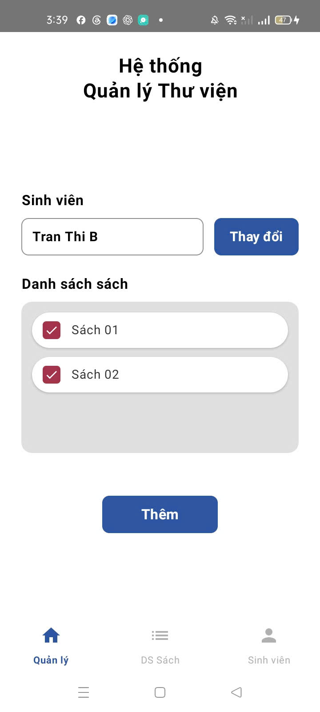

**Màn hình thêm sách vào kho:** 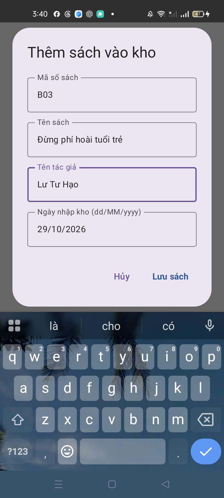

**Màn hình danh sách sách:** 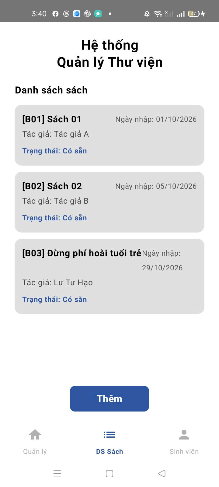

**Màn hình tạo phiếu mượn sách (lazy column1):** 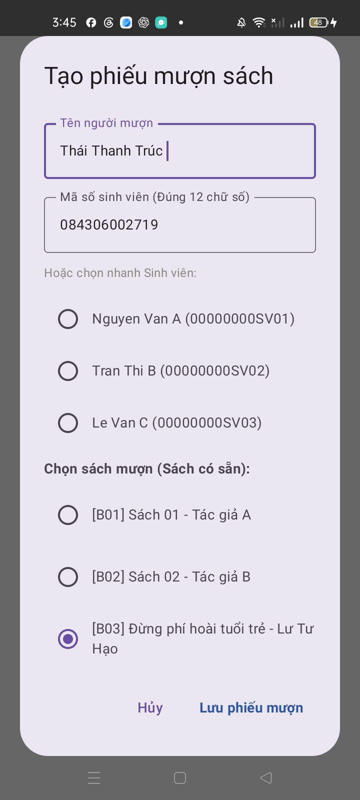

**Màn hình tạo phiếu mượn sách (lazy column2):** 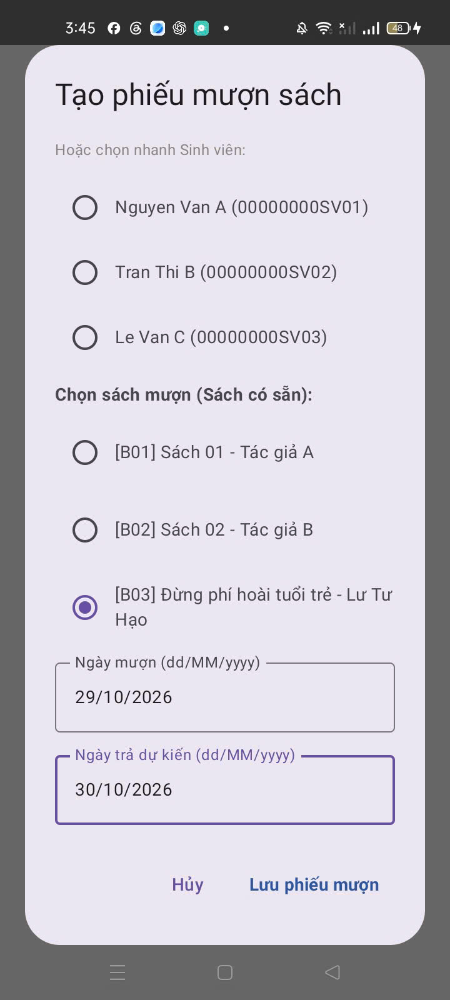

**Màn hình danh sách sách sau khi mượn:** 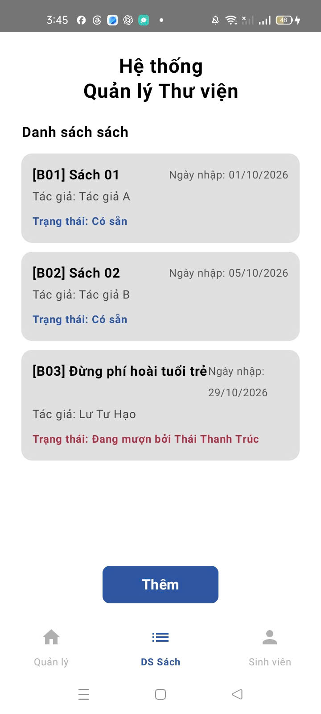

**Màn hình danh sách sinh viên:** 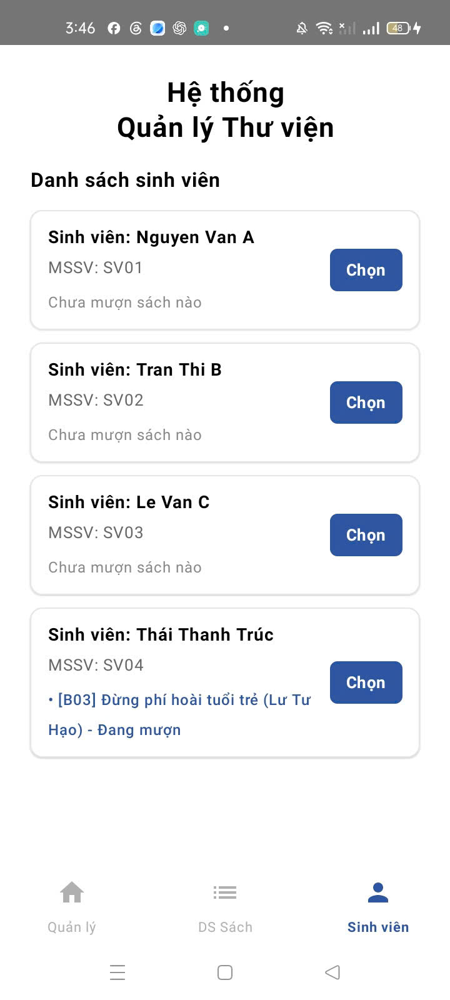

**Màn hình chi tiết mượn sách:** 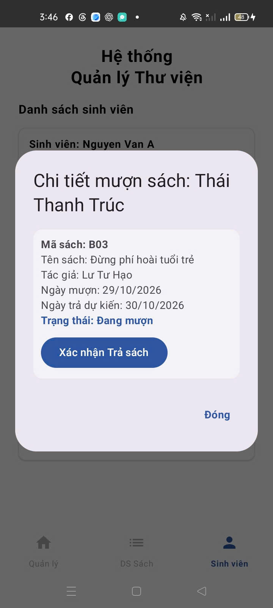

**Màn hình tạo phiếu mượn sách(trường hợp quá hạn):** 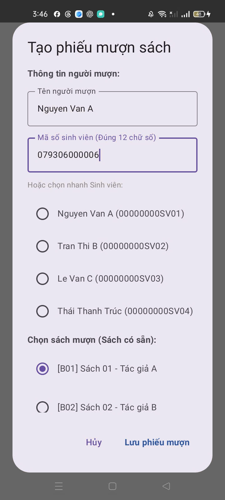

**Màn hình tình trạng quá hạn:** 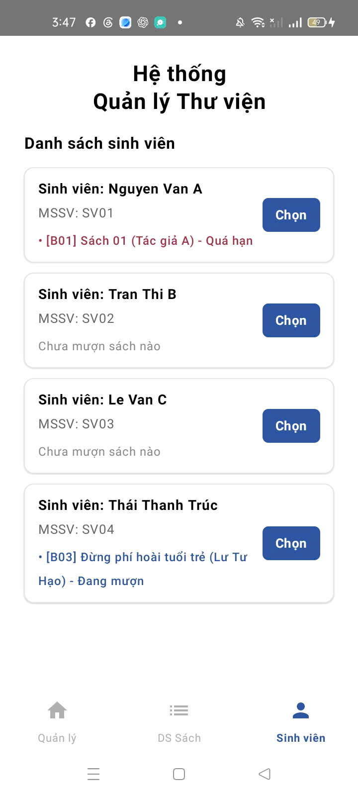

**Màn hình chi tiết phiếu quá hạn:** 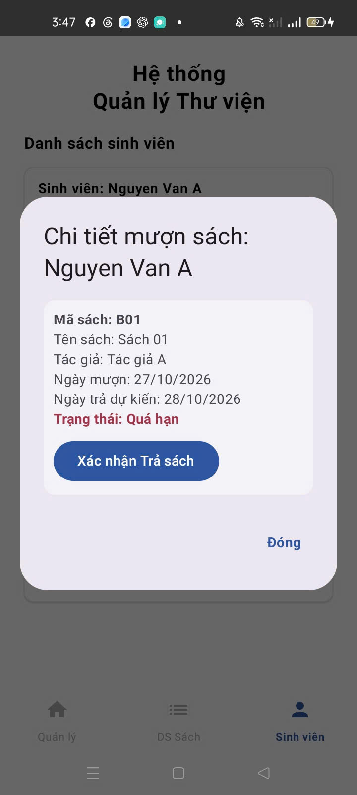

## 10. Bài học

Bài tập giúp củng cố kiến thức về lập trình hướng đối tượng, quản lý danh sách đối tượng, kiểm tra điều kiện, xử lý ngày tháng và xây dựng giao diện Android bằng Jetpack Compose. Qua đó, chương trình kết nối dữ liệu sách, sinh viên và phiếu mượn giữa các màn hình, đồng thời theo dõi trạng thái mượn/trả và ngày quá hạn.