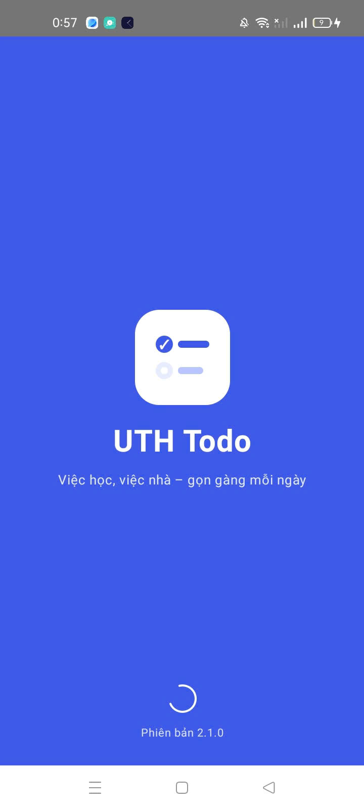
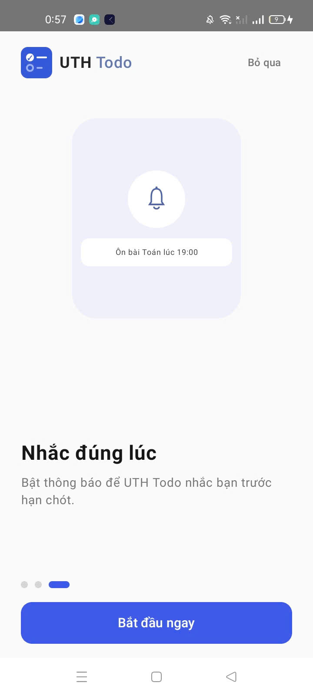

# Source Code – Bài tập: Thực hành Navigation + OOP – Tuần 4

## 1. Tổng quan chương trình

Chương trình xây dựng ứng dụng Android **UTH Todo** bằng Kotlin và Jetpack Compose, thực hành điều hướng màn hình bằng Navigation Compose và tổ chức dữ liệu theo hướng đối tượng (OOP).

Các chức năng chính:
- Hiển thị màn hình Splash.
- Giới thiệu ứng dụng qua 3 trang onboarding.
- Chuyển trang bằng nút “Tiếp tục”.
- Bỏ qua onboarding để đến màn hình Home.
- Quản lý dữ liệu bằng `data class`, Repository và UseCase.

## 2. Khai báo lớp OnboardingItem

```kotlin
enum class OnboardingIllustration {
    TASKS, CATEGORIES, REMINDERS
}

data class OnboardingItem(
    val title: String,
    val description: String,
    val illustration: OnboardingIllustration,
    val buttonText: String
)
```

Trong đó:
- `OnboardingItem`: lưu dữ liệu của một trang onboarding.
- `OnboardingIllustration`: xác định loại hình minh họa.
- `val`: khai báo thuộc tính chỉ đọc sau khi khởi tạo.

Sử dụng `data class` giúp đóng gói dữ liệu của mỗi trang thành một đối tượng.

## 3. Khởi tạo dữ liệu onboarding

File `OnboardingRepository.kt` cung cấp danh sách gồm 3 trang:

- Trang 1: Mọi việc, gọn trong một chỗ.
- Trang 2: Chia theo Học tập và Cuộc sống.
- Trang 3: Nhắc đúng lúc.

Hàm `getItems()` trả về danh sách `OnboardingItem`, giúp tách dữ liệu khỏi giao diện.

## 4. Xử lý nghiệp vụ bằng OnboardingUseCase

File `OnboardingUseCase.kt` có các hàm:

- `getPages()`: lấy danh sách trang.
- `getNextPage()`: xác định trang tiếp theo.
- `isLastPage()`: kiểm tra trang cuối.

Việc tách nghiệp vụ thành class riêng giúp code rõ ràng và dễ bảo trì.

## 5. Điều hướng bằng Navigation Compose

File `AppDestination.kt` khai báo các route:

```kotlin
object AppDestination {
    const val SPLASH = "splash"
    const val ONBOARDING = "onboarding"
    const val HOME = "home"
}
```

File `AppNavigation.kt` sử dụng `NavHost`, `NavController` và `composable()` để quản lý điều hướng.

Luồng hoạt động:

**Splash → Onboarding → Home**

Người dùng cũng có thể nhấn “Bỏ qua” để đến Home. Ba trang onboarding được chuyển đổi bằng trạng thái `currentPage`.

## 6. Hiển thị giao diện bằng Jetpack Compose

File `OnboardingScreen.kt` lấy dữ liệu từ `OnboardingUseCase` và hiển thị nội dung tương ứng.

| Thành phần | Chức năng |
|---|---|
| `Column`, `Row` | Sắp xếp giao diện |
| `Text` | Hiển thị nội dung |
| `IllustrationCard` | Hiển thị hình minh họa |
| `OnboardingIndicator` | Hiển thị vị trí trang |
| `PrimaryButton` | Thực hiện chuyển trang |
| `TodoLogo` | Hiển thị logo ứng dụng |

## 7. Kết quả kiểm thử

| Trường hợp | Kết quả mong đợi |
|---|---|
| Khởi động ứng dụng | Hiển thị Splash |
| Splash kết thúc | Chuyển đến onboarding |
| Nhấn “Tiếp tục” | Chuyển sang trang kế tiếp |
| Nhấn “Bỏ qua” | Chuyển đến Home |
| Hoàn thành trang cuối | Chuyển đến Home |

## 8. Ảnh chụp kết quả






## 9. Bài học
Bài tập giúp em củng cố kiến thức về Kotlin, OOP, `data class`, `enum class`, Repository, UseCase và Navigation Compose. Đồng thời, em biết cách tách dữ liệu, nghiệp vụ, điều hướng và giao diện thành các thành phần riêng biệt, giúp chương trình dễ đọc, bảo trì và mở rộng.
